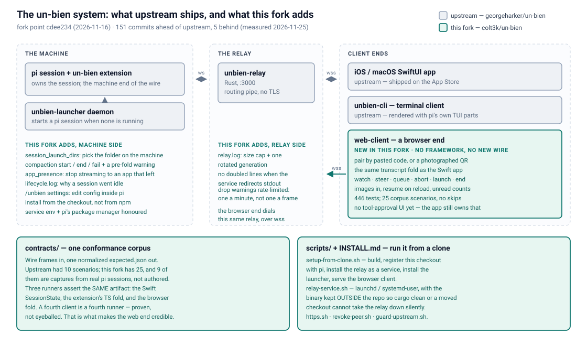
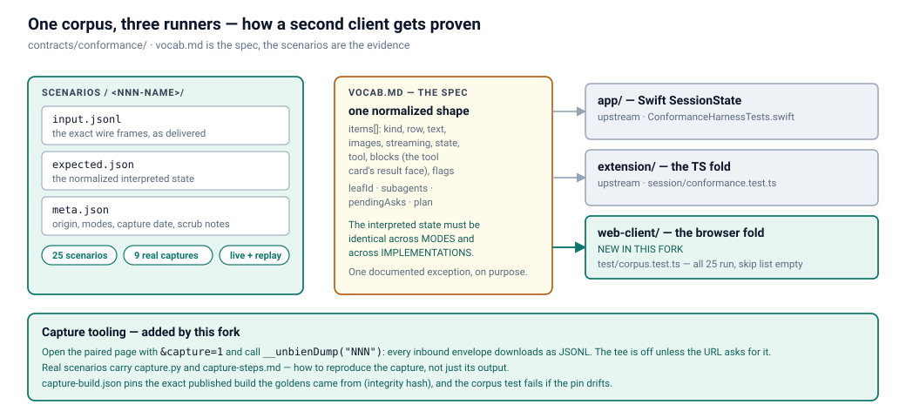
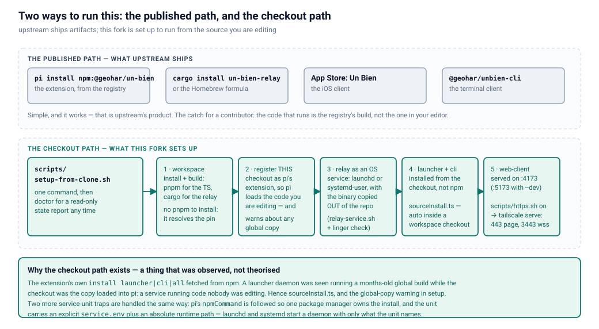

# This fork vs upstream

**What this is.** Upstream ([`georgeharker/un-bien`](https://github.com/georgeharker/un-bien))
ships a native iOS/macOS client, a Pi extension, and a Rust relay, all published —
App Store, npm, crates.io, Homebrew. This fork ([`colt3k/un-bien`](https://github.com/colt3k/un-bien))
keeps all of that and adds a **browser client**, turns the conformance corpus into
a **cross-implementation test harness with a third runner**, and makes the whole
thing **runnable from a clone** instead of only from published artifacts. It
publishes nothing.

If you want the product, use upstream. If you want to run this from source, or to
drive a Pi session from a browser, this is the checkout.

---

## Lineage, and where the fork sits

| Layer | Project                                                                           | What it contributed                                                                                                                                           |
| ----- | --------------------------------------------------------------------------------- | ------------------------------------------------------------------------------------------------------------------------------------------------------------- |
| 1     | [`remote_pi`](https://github.com/jacobaraujo7/remote_pi) — Jacob Moura            | The original relay + Pi extension + mobile app, and the wire protocol they speak.                                                                             |
| 2     | [`georgeharker/un-bien`](https://github.com/georgeharker/un-bien) — George Harker | The rpc-envelope protocol, the native SwiftUI app, the monorepo, the launcher daemon, the CLI, the durable plane, the conformance corpus, App Store shipping. |
| 3     | **this fork** — Gil Collins                                                       | The browser client, the corpus grown into a real harness, the from-clone operator story, and the machine-side changes those needed.                           |

Measured against upstream `main` on 2026-11-25:

|                  |                                                                                       |
| ---------------- | ------------------------------------------------------------------------------------- |
| Branch point     | `cdee234` (2026-11-16) — the first fork commit is `0b4eb77`, the browser-client spike |
| Ahead            | **151 commits** (148 excluding merges)                                                |
| Behind           | **5 commits** — upstream is merged in regularly, not abandoned                        |
| Merge-base today | `080ba05` (2026-11-21), after three upstream merges: `f32638f`, `93446ac`, `548e94f`  |

Rough size of the delta, by area:

| Area          | Added   | Removed | What it is                                                                   |
| ------------- | ------- | ------- | ---------------------------------------------------------------------------- |
| `contracts/`  | +29,982 | −18     | 15 new conformance scenarios (fixtures are most of the line count)           |
| `web-client/` | +23,716 | —       | the whole browser end: 12.0k lines of source, 6.9k of tests                  |
| `extension/`  | +7,112  | −1,576  | machine-side support for the browser end + install/service fixes             |
| `scripts/`    | +2,820  | −3      | 5 new operator scripts, 4 of them with their own tests                       |
| `docs/`       | +1,249  | −17     | `INSTALL.md`, `from-clone.md`, `pi-compaction-identity.md`, Android notes    |
| `app/`        | +642    | −73     | Swift kept aligned with the shared fold and the corpus — no new app features |
| `relay/`      | +373    | −58     | log file rotation, drop-warning rate limit                                   |
| `unbien-cli/` | +269    | −170    | follow-along for the shared client core                                      |

---

## The system, and which pieces came from where

---

## At a glance

|                       | Upstream                                                                   | This fork                                                                                  |
| --------------------- | -------------------------------------------------------------------------- | ------------------------------------------------------------------------------------------ |
| Client ends           | iOS/macOS SwiftUI app, `unbien` terminal client                            | **plus a browser client** — pair, watch, steer, launch, end from a phone browser           |
| Conformance corpus    | 10 scenarios, two runners (Swift, extension TS)                            | **25 scenarios, 9 captured from real Pi sessions, three runners**                          |
| Install path          | `pi install npm:@geohar/un-bien`, `cargo install un-bien-relay`, App Store | **plus `scripts/setup-from-clone.sh`**: everything built and registered from this checkout |
| Relay as a service    | launchd template via the extension                                         | **`scripts/relay-service.sh`**: launchd _and_ systemd-user, binary kept outside the repo   |
| TLS                   | out of scope ("the public edge's job")                                     | **`scripts/https.sh`**: `tailscale serve` in front of both the page and the relay          |
| Paired-device hygiene | pairing allow-list grows forever                                           | **`scripts/revoke-peer.sh`**: audit by evidence, revoke through the extension's own verb   |
| Publishing            | npm, crates.io, Homebrew, App Store, GitHub releases                       | **nothing** — `scripts/guard-upstream.sh` refuses if `origin` isn't upstream               |
| GitHub Actions        | ~281 App CI runs                                                           | **disabled by choice** on the fork; the suites are run locally, and the workflows say so   |

---

## 1. A browser client — the third end (`web-client/`)

This is the biggest addition, and it is a new _kind_ of end rather than a new feature:
no Swift, no install, no App Store. Open a URL on your phone, pair, and drive a Pi
session on your desktop.

It is deliberately a spike — one file per concern, no framework, no service worker,
no offline — built to answer a specific question: _can a non-Swift client drive a
session using the real wire, and how much of the transcript fold is actually hard?_
The answer turned out to be "yes, and the fold is the hard part", which is why §2
matters more than the UI.

What it does today:

- **Pair** by pasting an `unbien://pair?…` code, or by photographing the pairing QR
  (a photo upload, not a live camera stream — the camera API only exists in a secure
  context, and a plain-`http` LAN page is not one; `scripts/https.sh` is the way to
  get the live viewfinder).
- **Render the same transcript as the app**, by porting the app's fold rather than
  re-deriving it: pi's entry tree, the active-path backwalk, content identity for
  matching an id-less live frame to its durable entry, tool cards whose result face
  comes from the tool's declared spec, a deliberately small and safe Markdown subset,
  and pi's own tokyo-night colours.
- **Drive it**: prompt, steer mid-turn, queue a follow-up, abort, launch a new
  session (the folder list comes from the machine, so you pick from what the machine
  allows rather than typing a path), and end a session the way `/quit` does locally.
- **Behave on a phone**: the composer stays above a keyboard the browser reports
  badly, the transcript is windowed so a huge session doesn't freeze the tab, a
  reload puts back both the room _and_ the place you'd read to, unread counts per
  room, images in and out.
- **446 tests across 26 files**, and all 25 corpus scenarios run with an empty skip
  list.

What it does **not** do, stated plainly so nobody is surprised: no tool-approval UI
(the app still owns the permission surface), no slash-command registry (commands go
through as ordinary prompts and Pi expands them), no offline, no push notifications
anywhere in the project.

---

## 2. The conformance corpus, grown into a harness (`contracts/`)

Upstream had the right idea: a directory of scenarios, each a set of wire frames in
and one normalized `expected.json` out, asserted by _both_ the Swift reducer and the
extension's TypeScript fold. Ten scenarios, mostly authored.

This fork made it the thing the browser client is measured against:

- **10 → 25 scenarios**, and the new ones are **captures from real Pi sessions**, not
  hand-written frames. Nine declare `origin: real-capture`. That distinction is the
  point: authored fixtures encode what you already believed.
- **Capture tooling** so a capture is reproducible rather than lucky: `&capture=1`
  plus `__unbienDump("NNN")` in the browser downloads every inbound envelope; real
  scenarios carry `capture.py` and `capture-steps.md`; `capture-build.json` pins the
  exact published build (with its integrity hash) the goldens came from, and the
  corpus test fails if that pin drifts from the checkout.
- **A third runner** — the browser fold — so the claim "these clients agree" is
  checked three ways instead of two.
- **A scripted machine double** (`web-client/scripts/fake-machine.ts`) that drives
  the real Rust relay without Pi, so the browser end can be exercised end to end.
  Every frame it emits was copied from `extension/src`; it proves nothing about the
  real extension, and says so.

This is where the fork's real value is, and it is not browser-specific: **a fourth
client is a fourth runner, and is then proven rather than eyeballed.** The corpus
found live bugs on the way — eight status frames folded as eight blocking dialogs,
`turn_end` wrongly marking a session ended, a subagent panel stuck at `started`, a
row-order bug in the durable plane.

It also produced a finding about Pi itself, written up in
[`docs/pi-compaction-identity.md`](pi-compaction-identity.md): nothing on the wire
identifies a compaction, so a client has to anchor one by causality — and guessing
is where duplicate rows come from.

### One golden now describes the fork, not upstream

Scenario `015-real-live-turn` had its `expected.json` regenerated on 2026-11-27,
and the reason is worth knowing before you read a red conformance test.

The web client used to drop a `message_update` delta whose full frame equalled the
previous one — a redelivery guard ported from the reference
(`SessionState.swift:147`). But a delta frame carries no id and no timestamp;
`{type:"text_delta", contentIndex, delta}` is the whole of it. To that rule, "the
same frame arrived twice" and "the same character arrived twice" are the same
fact. It deleted characters out of every live reply — `Port 443` rendered
`Port 43`, `HTTP 200` rendered `HTP 20` — and only a reload showed the truth,
because the durable log was always correct and just this fold was not.

The guard is gone. The overlap it was written for is already handled by
architecture: every (re)attach calls `reset()` and does a full replay, and a
redelivered settled message is caught by `identifyIndex`. As a net, the settle
step now reconciles — if the streamed text is a **subsequence** of Pi's settled
text, which is the exact shape of "we lost characters" and also of a client that
joined mid-stream, the record wins. A row whose text genuinely differs is left
alone, because reflowing text someone has already read is worse than a gap.

015's golden had recorded the dropped text, so it changed. **The Swift client
still applies the old rule, so its conformance run against 015 now fails until it
is fixed too.** That is a real divergence, not a flaky fixture: either port the
fix to `SessionState.swift` or mark the scenario fork-divergent. The scenario's
`meta.json` carries the full note.

---

## 3. Machine-side changes the browser end needed (`extension/`)

Most of the extension delta exists because a browser is a worse-behaved client than
a native app: it drops constantly, joins mid-turn, and has no background process to
clean up after it.

- **`session_launch_dirs` / `session_launch_dirs_result`** — the machine answers
  "which folders may I start a session in", so the picker is rows you tap.
- **Compaction made visible**: `compaction_start` / `compaction_end` (including the
  failed and cancelled cases), plus a pre-compaction warning notice carrying Pi's own
  threshold math, so a viewer learns a fold is coming instead of watching the
  transcript go quiet.
- **`app_presence`** — stop streaming to an app that has gone away. A phone that
  dropped used to keep receiving every frame, which the relay dropped at the missing
  destination, forever.
- **`lifecycle.log`** — a small always-on record of session start/shutdown, why
  un-bien went idle, relay reconnect, mesh join/leave. Rare events, kept so "why did
  every Pi go idle at once" is answerable after the fact.
- **`/unbien settings`** — edit the global and per-folder config inside Pi, using
  Pi's own settings components.
- **Install from the checkout, not the registry** (`sourceInstall.ts`), Pi's
  `npmCommand` honoured so one package manager owns the whole install
  (`packageManager.ts`), and an explicit `service.env` plus a pinned absolute runtime
  path written into the service unit (`service_env.ts`).

That last group is the one that bites people who aren't running this fork, and it's
worth a diagram on its own:

---

## 4. The operator story (`scripts/`, `INSTALL.md`, `docs/from-clone.md`)

Five new scripts, four of them with their own `.test.sh`, and the script tests run
in the local suite (`pnpm test:scripts`).

| Script                | What it settles                                                                                                                                                                                                                                                                                                                                                                                                                                        |
| --------------------- | ------------------------------------------------------------------------------------------------------------------------------------------------------------------------------------------------------------------------------------------------------------------------------------------------------------------------------------------------------------------------------------------------------------------------------------------------------ |
| `setup-from-clone.sh` | Clone → running setup: workspace install, build, register _this checkout_ as Pi's extension, relay as an OS service, launcher daemon, serve the client. `doctor` gives a read-only report; `--dry-run` prints the plan.                                                                                                                                                                                                                                |
| `relay-service.sh`    | Own the relay service on macOS (launchd) **and** Linux (systemd-user). The binary is copied **outside** the repo, because a service pointed at `relay/target/release/` silently stops coming back after a `cargo clean` or a moved checkout. `status` flags a unit whose executable is missing — or is inside the repo. On Linux it checks `loginctl enable-linger`, because a user service without lingering is down from boot until someone logs in. |
| `https.sh`            | TLS in front of both ends via `tailscale serve`: the node's own `.ts.net` certificate, trusted by every device already on the tailnet — no warning page, no CA to install on a phone. The relay port it serves is a contract with `web-client/src/framing.ts`; change one without the other and the client dials a port nothing listens on.                                                                                                            |
| `revoke-peer.sh`      | Audit and revoke paired devices. Every device that ever paired stays on the allow-list forever, and a browser mints a fresh key each time, so the list fills with identities nobody can name. Revocation is gated on evidence — the private key still exists locally, or the key authenticated recently — never on pairing age. Removal goes through the extension's own verb, then the machine re-pushes the signed list.                             |
| `guard-upstream.sh`   | Refuse to publish from a fork. `push.sh` and `release.sh` name their target literally (upstream's auth needs that), which is correct upstream and dangerous anywhere else: a fork running `release.sh` would push commits _and_ the tags that trigger the npm / crates.io / Homebrew publishes into someone else's repo.                                                                                                                               |

`INSTALL.md` is the short front door for this path; `docs/from-clone.md` is the
runbook behind it, with the author's hostnames, tailnet, IPs and paths replaced by
placeholders.

---

## 5. Relay log hygiene (`relay/`)

Small, but it fixes two things that make a self-hosted relay unpleasant:

- **`log_file.rs`** — `relay.log` is size-capped with one rotated generation, and
  `init_tracing` drops its stdout layer when stdout _is_ that file, so the service
  units' redirect no longer doubles every line.
- **`drop_log.rs`** — one departed app used to produce a warning per streamed frame,
  several a second, for hours. Now: first drop reported, then at most one line per
  minute carrying the count.

---

## What this fork does _not_ change

Worth saying, because it bounds the risk of running it:

- **The wire protocol and the trust model are upstream's.** Ed25519 pairing, the
  three-key identity model, the relay as a dumb pipe that can see routed plaintext,
  the mesh authority — untouched. The fork's additions are **additive frames**
  (`session_launch_dirs`, `compaction_start`) and behaviour, not a forked protocol.
- **The Swift app is upstream's.** The fork's ~640 lines there keep the app aligned
  with the shared fold and the corpus; no new app features.
- **Nothing is published from here.** npm, crates.io, Homebrew and the App Store stay
  upstream's. The fork's `chore(release)` commits are local version bumps — and note
  the hazard: the fork bumped `0.25.19` on 2026-11-21 and upstream published
  `0.25.19` to npm on 2026-11-22, so a version number here is _not_ the same bytes as
  that number on the registry. `guard-upstream.sh` is what keeps this from getting
  worse.
- **No CI on this remote, by decision.** GitHub's fork-level Actions disable is left
  on; the workflows now describe that honestly instead of pretending to gate merges.
  The suites are the ones _you_ run: `pnpm test`, `pnpm test:scripts`, and
  `swift test` in `app/`.

---

## Keeping the fork sane

- Upstream is merged in, not cherry-picked around — three merges so far, currently
  5 commits behind.
- `contracts/conformance/capture-build.json` records which published build each
  fixture came from, and the corpus test fails if the pin drifts. It also carries a
  correction of an earlier wrong claim the fork made about its own state — kept
  rather than deleted, because the mistake is instructive.
- Decisions are written down where they'll be found: thinking notes stay live-only
  (matching what Pi's own screen replays), branch summaries stay invisible, Actions
  stay off. `docs/` and the workflow files say so, with dates.

---

## Read next

| If you want to…                          | Go to                                                                                                                 |
| ---------------------------------------- | --------------------------------------------------------------------------------------------------------------------- |
| run this checkout end to end             | [`INSTALL.md`](../INSTALL.md), then [`docs/from-clone.md`](from-clone.md)                                             |
| use the browser client                   | [`web-client/USAGE.md`](../web-client/USAGE.md) — and `web-client/README.md` for why the fold is shaped the way it is |
| know the ports, processes and config     | [`docs/web-client-anatomy.md`](web-client-anatomy.md)                                                                 |
| build another client                     | [`contracts/conformance/vocab.md`](../contracts/conformance/vocab.md), then [`docs/rpc-envelope.md`](rpc-envelope.md) |
| know what upstream ships                 | upstream's [docs site](https://docs.georgeharker.com/un-bien) — this fork's docs are not published there              |
| judge whether an Android app is worth it | [`docs/android-client-feasibility.md`](android-client-feasibility.md)                                                 |
