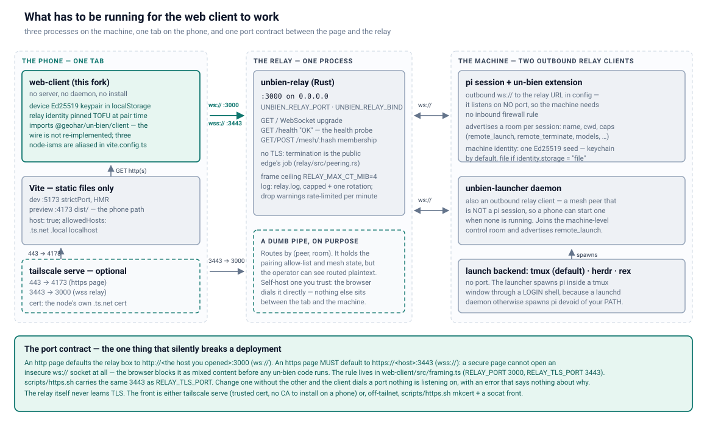
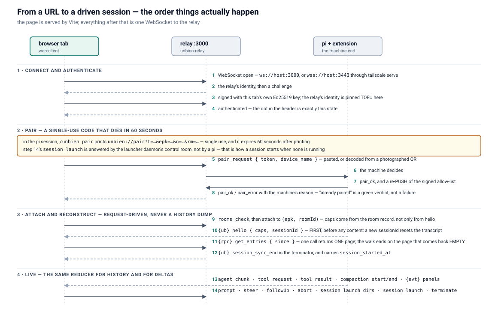
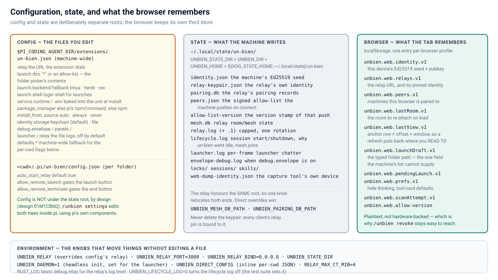

# Web client anatomy: applications, ports and configuration

What actually has to exist, and be configured, for a browser tab to drive a Pi
session. This is the wiring diagram, not the user guide — for "get it running",
start with [`INSTALL.md`](../INSTALL.md); for "why the transcript fold looks like
this", read [`web-client/README.md`](../web-client/README.md).

---

## The short answer

**Three processes on the machine, one tab on the phone.** Two of the three
processes make outbound connections only — nothing on the machine listens for the
phone, which is why this works from behind a normal home router.

| Piece             | Process                      | Listens on                   | Started by                             |
| ----------------- | ---------------------------- | ---------------------------- | -------------------------------------- |
| The page          | Vite (`dev` or `preview`)    | `:5173` dev, `:4173` preview | `web-client/scripts/start.sh`          |
| The relay         | `unbien-relay` (Rust)        | `:3000` on `0.0.0.0`         | an OS service (launchd / systemd-user) |
| The machine end   | `pi` + the un-bien extension | **nothing** — outbound only  | you, in a terminal                     |
| The launcher      | `unbien-launcher`            | **nothing** — outbound only  | an OS service                          |
| Optional TLS edge | `tailscale serve`            | `:443`, `:3443`              | `scripts/https.sh on`                  |
| The client        | a browser tab                | nothing                      | you, on a phone                        |



The one line worth memorising:

> An `http` page dials `ws://host:3000`. An `https` page **must** dial
> `wss://host:3443`. A secure page cannot open an insecure WebSocket at all — the
> browser blocks it as mixed content before any un-bien code runs.

---

## The four pieces, one at a time

### 1. The browser tab

It is not a server, not a PWA, and has no service worker — "Add to Home screen"
works, offline does not. It holds two things that matter:

- **Its own device identity.** One Ed25519 keypair per browser profile, in
  `localStorage`, in the same `{seed, publicKey}` shape the CLI uses at
  `~/.local/state/un-bien/proxy-identity.json`. It pairs on its own token and is
  revoked on its own, so re-pairing the phone never implies re-pairing the laptop.
- **The relay's identity, pinned TOFU** at pair time. That pin is bound to the
  relay's keypair — deleting `relay-keypair.json` on the machine breaks every
  client's pin at once.

The wire is **not** re-implemented. The tab imports `@geohar/un-bien/client` — the
same transport, pairing crypto, base64 canonicalization and envelope framing the
machine runs — with three node-isms aliased away in `web-client/vite.config.ts`:

| Import in the core | Aliased to                    | Why                                                                                               |
| ------------------ | ----------------------------- | ------------------------------------------------------------------------------------------------- |
| `node:crypto`      | `src/shims/node-crypto.ts`    | the core only touches `createHash` (sha256/sha512) and `randomBytes`                              |
| `node:events`      | the `events` package, by path | `RelayClient extends EventEmitter`; Vite externalizes the bare specifier                          |
| `ws`               | `src/shims/ws.ts`             | native `WebSocket` behind `ws`'s `.on/.once/terminate` surface                                    |
| `*/debug_log.js`   | `src/shims/debug-log.ts`      | a file-backed diagnostic; the alias also keeps the extension's `fs`/paths chain out of the bundle |

The `debug_log.js` alias uses a full-specifier regex on purpose: a partial match
would splice the shim path onto the leftover `../session/` prefix.

### 2. Vite — the only thing that serves the page

Two modes, and the choice is not cosmetic:

| Mode      | Port                  | Use it for                                                                                                                                                |
| --------- | --------------------- | --------------------------------------------------------------------------------------------------------------------------------------------------------- |
| `dev`     | `5173` (`strictPort`) | at a desk. HMR socket drops on a tailnet blip or a backgrounded tab and **full-reloads the page**, which looks exactly like the client losing the session |
| `preview` | `4173`                | **on a phone.** Serves the built `dist/`                                                                                                                  |

Both bind every interface (`host: true`) and set
`allowedHosts: [".ts.net", ".local", "localhost"]`. That list matters more than it
looks: Vite allows any **IP** host header unconditionally, so
`http://192.168.1.86:5173` needs no configuration at all — but an mDNS name like
`my-mac.local` is not an IP and would get a 403 without `.local` in the list. It
stays a list rather than `true` so Vite's DNS-rebinding protection still applies to
everything else.

`strictPort` is deliberate: if `:5173` is taken, Vite refuses rather than quietly
picking `:5174` and leaving the printed URL wrong.

Vite can hold a TLS cert itself (`UNBIEN_TLS_KEY` / `UNBIEN_TLS_CERT`), but the
default https deployment does **not** use that — `tailscale serve` terminates TLS
at the edge and proxies plain http to Vite, so the browser sees https and Vite
never holds a key.

**Rebuilding while a phone is connected is the one thing to be careful about.**
`vite build` empties `outDir` before writing it, so a plain rebuild leaves a live
`:4173` with no `index.html` and no assets for the length of the build. And it is
worse than a bad reload: the QR decoder is a separate lazily-imported chunk
(`qr-decode.ts` does `await import("jsqr")`), so a tab that never reloaded still
breaks — at scan time, when it asks for the old hashed filename. Build through
`web-client/scripts/build-swap.sh`: it builds into `dist.build-<stamp>/` and
renames the `dist` symlink over (atomic), then carries the previous build's
assets forward so names already served stay fetchable. `start.sh preview` calls
it for you.

**And the failure is now loud instead of invisible.** Vite's default
`appType: "spa"` makes dev and preview answer _any_ unmatched path with
`index.html` at status **200** — including a hashed JS module that is not there.
A missing chunk therefore arrives as HTML with a 200, the browser parses it as a
module, and the symptom is `SyntaxError: Unexpected token '<'` with **no 404
anywhere in the network log**. A reload fails for the same reason, so the tab
looks unrecoverable and the server looks like the only thing left to restart.
This client has no path-based routing — the only history call (`app.ts`, the
`?fresh=1` hatch) rewrites the query string — so `vite.config.ts` sets
`appType: "mpa"` and a missing asset is an honest 404.

### 3. The relay — one port, three endpoints

`unbien-relay` is a Rust process that listens on one port and does three things on
it:

| Endpoint               | Purpose                                                                  |
| ---------------------- | ------------------------------------------------------------------------ |
| `GET /`                | the WebSocket upgrade — every client, machine and browser                |
| `GET /health`          | returns `OK`; this is the probe `setup-from-clone.sh` and `start.sh` use |
| `GET/POST /mesh/:hash` | mesh membership                                                          |

```
UNBIEN_RELAY_PORT   default 3000
UNBIEN_RELAY_BIND   default 0.0.0.0 (all interfaces); accepts a host:port list
RELAY_MAX_CT_MIB    default 4 — the outer-envelope frame ceiling
```

The relay **never learns TLS** — `relay/src/peering.rs` says termination is the
public edge's job. It is also a deliberately dumb pipe: it routes by
`(peer, room)`, holds the pairing allow-list and mesh state, and its operator can
read routed plaintext. Self-host one you trust.

Two log-hygiene behaviours are worth knowing when you go looking for a problem:

- `relay.log` is size-capped with one rotated generation (`relay.log.1`), and the
  tracing layer for stdout is dropped when stdout _is_ that file — otherwise the
  service units' redirect and the file layer would double every line.
- A departed app used to produce one "dest not found, dropping" warning per
  streamed frame. Now: the first drop, then at most one line per minute carrying
  the count.

### 4. The machine end — two outbound clients

**The extension** runs inside `pi`. It dials the relay URL from config and
advertises a room per session, with caps (`remote_launch`, `remote_terminate`,
`models`, `thinking`, …). It listens on no port.

**The launcher daemon** (`unbien-launcher`) is a mesh peer that is _not_ a Pi
session. It exists so a phone can start a session when none is running: it joins
the machine-level control room and advertises `remote_launch`. Without it you can
still pair, watch and drive any session that is already up.

The launcher then spawns Pi through a **launch backend** — `tmux` (default),
`herdr`, or `rex` — none of which listen on a port. This is the capability that
changes what you can do without you noticing: **no tmux, no remote launch.** The
launch runs through a _login_ shell, because a launchd daemon otherwise spawns Pi
devoid of your `PATH`.

---

## The order things happen



Three details in that sequence are the ones that cause real confusion:

**Pairing is awaited, not fire-and-forget.** A `pair_request` that isn't awaited
can look like it worked while nothing was stored, and `rooms_check` is then refused
with `unknown_peer` forever.

**The code expires 60 seconds after it was printed.** That is why a QR scan pairs
straight away and a copy-paste needs to be quick.

**Caps do not only come from `hello`.** A resumed session — a reload, a phone tab
recycled in the background, a reconnect — gets **no** `hello` frame. When caps were
read only from `hello`, the **end** button sat hidden on a live, drivable session
while the header said `synced`. Caps are now seeded from the machine's own room
record at attach and filled in when the listing lands later.

**Reconstruction is paged, and the terminator is the empty page.** One
`get_entries` call returns one page and looks like a short history. A non-empty
page's `leafId` is a resume cursor; the active-leaf beacon is the `leafId` of the
page that came back **empty**.

---

## Ports, in one table

| Port   | Who                      | Direction              | Notes                                                          |
| ------ | ------------------------ | ---------------------- | -------------------------------------------------------------- |
| `3000` | `unbien-relay`           | inbound to the machine | `UNBIEN_RELAY_PORT`. Bound to `0.0.0.0` by default             |
| `3443` | tailscale serve → relay  | TLS front              | **must match** `RELAY_TLS_PORT` in `web-client/src/framing.ts` |
| `4173` | Vite preview             | inbound                | the phone path                                                 |
| `5173` | Vite dev                 | inbound                | HMR; `strictPort`                                              |
| `443`  | tailscale serve → `4173` | TLS front              | an `https` page                                                |
| `5174` | tailscale serve → `5173` | TLS front              | only with `https.sh on --dev`                                  |

The `3443` duplication is a genuine hazard, and both files say so in a comment:
`scripts/https.sh` carries it as `RELAY_TLS_PORT`, `web-client/src/framing.ts`
carries it as `RELAY_TLS_PORT`. Change one without the other and the client dials
a port nothing is listening on, with an error that says nothing about why.

---

## Configuration: which file decides what



Config and state are **separate roots on purpose** (design `01M1CB6Q`). Moving the
state root does not move config, and config never ends up next to the logs.

### Machine-wide config — `$PI_CODING_AGENT_DIR/extensions/un-bien.json`

| Key                                    | What it decides                                                            |
| -------------------------------------- | -------------------------------------------------------------------------- |
| `relay`                                | the URL the extension dials. `UNBIEN_RELAY` overrides it                   |
| `launch.dirs`                          | `"*"` (default) or an allow-list — this **is** the browser's folder picker |
| `launch.backend` / `launch.fallback`   | `tmux` · `herdr` · `rex`, and what to use when that one is unavailable     |
| `launch.shell` / `shell_args`          | the login shell remote launches run through                                |
| `service.runtime` / `service.env`      | baked into the launchd/systemd unit **at install time**                    |
| `package_manager`                      | else pi's `npmCommand`, else npm                                           |
| `install_from_source`                  | `auto` (default) · `always` · `never`                                      |
| `identity.storage`                     | `keychain` (default) or `file` — the headless option                       |
| `debug.envelope/panels/launcher/relay` | the file-based logs; all off by default                                    |
| `defaults.*`                           | machine-wide fallback for the per-cwd flags below                          |

`launch.dirs` is read fresh on every launch request, so edits take effect without a
restart. An **empty array** means nothing is launchable, and the client says so
rather than showing an empty picker.

### Per-folder config — `<cwd>/.pi/un-bien/config.json`

| Key                      | What it decides                                                |
| ------------------------ | -------------------------------------------------------------- |
| `auto_start_relay`       | default `true`                                                 |
| `allow_remote_launch`    | gates the launch button — the cap is not advertised without it |
| `allow_remote_terminate` | gates the **end** button                                       |

`/unbien settings` edits both trees inside Pi with Pi's own settings components.
Lists (`launch.dirs`, `service.env`) and the identity backend stay file-only —
switching the key store is where pairing can break, so it is shown but not
editable.

### Environment

| Variable                                         | Effect                                                            |
| ------------------------------------------------ | ----------------------------------------------------------------- |
| `UNBIEN_RELAY`                                   | relay URL, wins over config                                       |
| `UNBIEN_RELAY_PORT`                              | relay listen port (default `3000`)                                |
| `UNBIEN_RELAY_BIND`                              | bind spec (default `0.0.0.0`)                                     |
| `UNBIEN_STATE_DIR`                               | moves **all** state — the extension's and the relay's, together   |
| `UNBIEN_MESH_DB_PATH` / `UNBIEN_PAIRING_DB_PATH` | direct overrides that win over the state root                     |
| `UNBIEN_RELAY_BIN_DIR`                           | where `relay-service.sh` puts the binary (default `~/.cargo/bin`) |
| `UNBIEN_DAEMON=1`                                | headless init; set for the launcher                               |
| `UNBIEN_DIRECT_CONFIG`                           | the value _is_ the per-cwd JSON — for detached processes          |
| `RELAY_MAX_CT_MIB`                               | frame ceiling in MiB (default `4`)                                |
| `RUST_LOG`                                       | beats `debug.relay` for the relay's log level                     |
| `UNBIEN_LIFECYCLE_LOG=0`                         | turn the lifecycle log off (the test suite sets it)               |

### What the browser remembers

| `localStorage` key            | Why it exists                                                                       |
| ----------------------------- | ----------------------------------------------------------------------------------- |
| `unbien.web.identity.v1`      | this device's Ed25519 seed + pubkey                                                 |
| `unbien.web.relays.v1`        | the relay URL and its pinned identity                                               |
| `unbien.web.peers.v1`         | machines this browser is paired to                                                  |
| `unbien.web.lastRoom.v1`      | the room to re-attach on load (a hint, not a promise — room ids rotate per session) |
| `unbien.web.lastView.v1`      | anchor row + offset + window, so a refresh puts back where you had **scrolled to**  |
| `unbien.web.launchDraft.v1`   | the typed folder path — the one field the machine's allow-list cannot supply        |
| `unbien.web.pendingLaunch.v1` | a launch that survives a refresh                                                    |
| `unbien.web.prefs.v1`         | hide thinking, tool-card defaults                                                   |
| `unbien.web.scanAttempt.v1`   | the last QR scan's outcome, so "it showed nothing" is answerable                    |

The view state is stored as a **row id, not a pixel offset**, because an offset
means nothing across a reload — row heights depend on images that have not loaded
and rows the window has not drawn yet.

---

## The service units

Two units, both rendered from `extension/service-templates/`.

|             | relay                                         | launcher                                                    |
| ----------- | --------------------------------------------- | ----------------------------------------------------------- |
| macOS label | `com.georgeharker.unbien.relay`               | `com.georgeharker.unbien.launcher`                          |
| macOS file  | `~/Library/LaunchAgents/<label>.plist`        | same                                                        |
| Linux unit  | `~/.config/systemd/user/unbien-relay.service` | `unbien-launcher.service`                                   |
| Executable  | `~/.cargo/bin/unbien-relay`                   | `<node abs path> <checkout>/extension/dist/bin/launcher.js` |
| Logs        | `<state>/relay.log`                           | `<state>/launcher.log` (journal on Linux)                   |

A real installed relay unit, on the machine this repo runs on:

```plist
ProgramArguments   = /Users/<you>/.cargo/bin/unbien-relay
RunAtLoad          = false
KeepAlive          = { Crashed = true; SuccessfulExit = false }
StandardOutPath    = ~/.local/state/un-bien/relay.log
StandardErrorPath  = ~/.local/state/un-bien/relay.log
Environment        = UNBIEN_RELAY_PORT=3000
                     UNBIEN_STATE_DIR=~/.local/state/un-bien
                     RUST_LOG=info
```

That `RunAtLoad=false` + `KeepAlive={Crashed, SuccessfulExit=false}` combination is
what `start.sh relay up|down` relies on: launchd supervises it and restarts a
crash, but a deliberate stop **stays stopped** and nothing starts it at login. The
shipped template is `RunAtLoad=true` + `KeepAlive=true`, so `/unbien install relay`
gives you an always-on relay instead. Know which one you have before you go looking
for the relay.

The launcher unit is the interesting one: its `ProgramArguments` point at **this
checkout's** `extension/dist/bin/launcher.js` with an absolute node path, and its
`EnvironmentVariables.PATH` is the PATH of the shell that installed it. Two
consequences:

1. **Run the installer from a normal login shell.** The unit embeds that shell's
   `node` and `PATH`; a sparse shell gives the daemon a `PATH` without `tmux` or
   `pi`, and remote launch fails in a way that looks like a client bug.
2. **The binary must not live in `relay/target/release/`.** That directory is build
   output: `cargo clean` empties it and moving the repo invalidates the absolute
   path baked into the unit. The service manager resolves that path fresh on every
   restart, so the day you clean or move the repo the relay silently stops coming
   back — `KeepAlive` cannot restart what it cannot find, and a reboot makes it
   permanent. Hence `relay-service.sh`, which copies the binary to `~/.cargo/bin`
   (where the extension's `findRelayBinary()` already looks — otherwise
   `/unbien install relay` concludes the relay is missing and `cargo install`s a
   published copy over your service) and whose `status` verb flags a unit whose
   executable is missing, **or is inside the repo**.

On Linux there is one extra trap: a `systemd --user` unit only runs while the user
has a session. On a headless box that means the relay is down from boot until
someone logs in, and down at every logout. `relay-service.sh` checks and says so:

```sh
sudo loginctl enable-linger "$USER"
```

---

## Two supported deployments

### LAN only — no Tailscale, no TLS

A supported setup, not a degraded one. Pairing crypto is Ed25519 from `@noble`, not
WebCrypto, so plain `http` does not lock you out.

```sh
scripts/setup-from-clone.sh          # builds, registers, installs both services, serves :4173
# open http://<machine>.local:4173  or  http://192.168.1.86:4173
# relay URL in the drawer: http://<same host>:3000
```

What you give up: no live camera viewfinder for QR pairing (`getUserMedia` is a
secure-context API — on plain `http` it is not denied, it is **absent**), so
pairing-by-scan is a photo upload. And `:5173` is usable from a phone, but with the
HMR reload trap.

### Tailnet + TLS — the phone path

```sh
scripts/https.sh on          # 443 -> 4173, 3443 -> 3000
scripts/https.sh status      # what is served, and the URLs to paste
```

`tailscale serve` terminates TLS with the node's own `.ts.net` certificate, which
every device already on the tailnet trusts — no warning page, no CA to install on a
phone. On iOS a self-signed cert means a profile install plus the Certificate Trust
Settings toggle nobody finds, which is why `mkcert` + a `socat` front is the
off-tailnet fallback rather than the default.

---

## What breaks when a piece is wrong

| Symptom                                     | Cause                                                                                                                                                                                     |
| ------------------------------------------- | ----------------------------------------------------------------------------------------------------------------------------------------------------------------------------------------- |
| Pair button does nothing, no error anywhere | historically `crypto.randomUUID` being `undefined` on a plain-`http` origin, rejecting inside `pairAwaited` where no `catch` saw it. Now `src/framing.ts` falls back to `getRandomValues` |
| Page loads, relay never connects            | an `https` page dialing `ws://…:3000` — mixed content, blocked before any un-bien code runs                                                                                               |
| Client dials a port nothing is on           | `https.sh`'s `RELAY_TLS_PORT` and `framing.ts`'s disagree                                                                                                                                 |
| `403` on `http://my-mac.local:5173`         | mDNS names are not IPs; `.local` must be in `allowedHosts`                                                                                                                                |
| The page reloads on its own                 | you are on `dev` from a phone — the HMR socket dropped                                                                                                                                    |
| `rooms_check` refused: `unknown_peer`       | pairing never completed (an un-awaited `pair_request`), or the code expired                                                                                                               |
| **end** button missing on a live session    | the machine doesn't advertise `remote_terminate` (`allow_remote_terminate`), or a resumed session got no `hello`                                                                          |
| Launch panel has no folders                 | `launch.dirs` is an empty array, or `allow_remote_launch` is off, or no launcher daemon                                                                                                   |
| Launch fails with a backend error           | `tmux` missing, or the unit's `PATH` came from a sparse shell                                                                                                                             |
| Relay silently stops coming back            | the unit points inside the repo — `cargo clean` or a moved checkout                                                                                                                       |
| Relay down until someone logs in (Linux)    | `systemd --user` without lingering                                                                                                                                                        |
| Two extensions loaded, weird behaviour      | a global `npm:@geohar/un-bien` entry still in Pi's `settings.json` next to this checkout — Pi treats them as separate packages and loads **both**; `setup-from-clone.sh` warns            |
| Every client's relay pin breaks at once     | `relay-keypair.json` deleted from the state dir                                                                                                                                           |

| Launcher gone, `launcher.log` **empty**, `last exit code = 78: EX_CONFIG` | the unit's `ProgramArguments[0]` no longer exists — `brew upgrade node` deleted the versioned Cellar path it baked. The daemon survived the upgrade on an open image and died at its next restart; see `docs/from-clone.md` §5 |
| Phone tab 404s, or QR scanning dies on a tab you never reloaded | a plain `vite build` emptied `dist/` under a live `vite preview` — use `web-client/scripts/build-swap.sh`, which `start.sh preview` already calls |

| Blank tab, console `SyntaxError: Unexpected token '<'`, **no 404 in the network log** | the SPA fallback answered a missing hashed chunk with `index.html` at status 200 — `vite.config.ts` now sets `appType: "mpa"`, so it is a plain 404 |

| Assistant text missing repeated characters — `443` shows as `43`, `HTTP` as `HTP` — and looks right after a reload | the fold deduped deltas by CONTENT, and a delta frame has no id, so "same frame twice" and "same character twice" were one fact. Guard removed 2026-11-27; the settle step now reconciles against Pi's record |

---

## Dev-only pieces that touch the same ports

| Thing                                      | What it is                                                                                                                                                                                                                 |
| ------------------------------------------ | -------------------------------------------------------------------------------------------------------------------------------------------------------------------------------------------------------------------------- |
| `web-client/scripts/fake-machine.ts`       | a scripted machine double that drives the **real Rust relay** without Pi, so the browser end can be exercised end to end. Every frame it emits was copied from `extension/src`; it proves nothing about the real extension |
| `?capture=1` + `__unbienDump("NNN")`       | tee every inbound envelope to JSONL for a conformance fixture. Off unless the URL asks for it                                                                                                                              |
| `?fresh=1`                                 | open the viewer without replaying the last room                                                                                                                                                                            |
| `?kbdebug`                                 | a panel of viewport facts, for keyboard-inset problems that only reproduce on the phone                                                                                                                                    |
| `contracts/conformance/capture-build.json` | pins the exact published build the fixtures came from, with its integrity hash; the corpus test fails if the pin drifts                                                                                                    |

---

## Checking it is up

```sh
web-client/scripts/start.sh doctor      # node, pnpm, ports, relay — starts nothing
web-client/scripts/start.sh relay status
curl -s http://127.0.0.1:3000/health    # -> OK
scripts/relay-service.sh status         # the unit, and whether its binary is where it claims
scripts/https.sh status                 # what tailscale serve is doing, and the URLs to paste
scripts/setup-from-clone.sh doctor      # read-only report of the whole setup
```

`start.sh stop` only kills a listener whose **working directory is this checkout** —
matching on process name alone once killed an unrelated dev server that happened to
be a node process on the same port.
